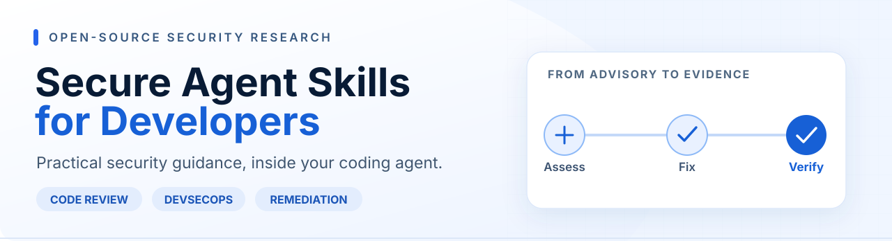

**A drop-in security companion for the tools developers already use.**

Seven open-source [Agent Skills](https://agentskills.io/specification) for **Claude Code, Claude Cowork, Cursor and OpenAI Codex**. Review an application, trace vulnerable components, prepare changes and assemble verification evidence—without adding another security platform.

**[Get started](#get-started) · [Explore the skills](#the-skill-library) · [Research methodology](docs/methodology.md) · [Contribute](CONTRIBUTING.md)**

---

## Why this exists

A security advisory tells you **what** needs attention. It rarely tells you **where** the affected runtime, dependency or trust configuration lives across source code, build files and deployed services.

This project brings structured, evidence-led security workflows into the developer's coding agent:

**Advisory → Exposure assessment → Proposed fix → Tests → Deployment verification**

The skills assist developers and security teams. They do **not** replace official vendor patches, scanners, human review, incident response or regulatory assessments.

## Get started

**Requirements:** Python 3.10+, Git and an Agent Skills-compatible coding agent. The skills themselves are Markdown instructions. The installer uses only the Python standard library.

~~~bash
git clone https://github.com/kipronorugut/secure-vibe-coding.git
cd secure-vibe-coding

# Choose ONE agent and replace the path with your application folder.
python3 tools/install.py --agent cursor --project /path/to/your/app
# python3 tools/install.py --agent claude --project /path/to/your/app
# python3 tools/install.py --agent codex  --project /path/to/your/app
~~~

**Only need vulnerability remediation?** Install one skill:

~~~bash
python3 tools/install.py --agent cursor \
  --project /path/to/your/app \
  --skill cve-to-pr-remediation
~~~

Then ask your coding agent:

> Use **cve-to-pr-remediation** to verify this advisory against vendor guidance, check whether this application is affected, and prepare the smallest supported fix with tests and deployment checks. **Start read-only.** Ask before changing files, executing commands, accessing the network or opening a PR. Separate proposed changes from verified production remediation.

The installer copies skill folders into your selected application; it does not execute that application's code or run scans. Existing skills are left unchanged unless you use `--update`, which retains a backup of the prior installed folder.

<strong>Other installation options: Claude Code, Cursor, Codex and Cowork</strong>

| Agent | Project skill directory | User skill directory |
| :-- | :-- | :-- |
| **Claude Code** | `.claude/skills/` | `~/.claude/skills/` |
| **Cursor** | `.cursor/skills/` | `~/.cursor/skills/` |
| **OpenAI Codex** | `.agents/skills/` | `~/.agents/skills/` |

To install for your user account, run `python3 tools/install.py --agent codex --scope user` (change the agent as needed).

**Manual install:** Copy any `skills/<skill-id>/` folder into a supported skill directory. Review `SKILL.md` before using it.

**Claude Cowork:** Generate one ZIP per skill with `python3 tools/package_cowork.py`. In Claude, use the Skills upload workflow to import an individual ZIP. Cowork may not have direct local terminal or repository access; provide files and confirm tool availability.

**Updates:** Pass `--update` to replace a previously installed copy of the same skill. The original copy and any custom edits are retained in a hidden `.backup-*` directory. Review that backup before cleanup.

## The skill library

| Skill | Primary use | Open |
| :-- | :-- | :-- |
| **CVE-to-PR Remediation** | Validate advisories, trace version pins, propose fixes, plan tests and deployment evidence. | [View skill](skills/cve-to-pr-remediation/SKILL.md) |
| **Secure Code Review** | Review access controls, injection risks, sensitive flows and security-critical diffs. | [View skill](skills/secure-code-review/SKILL.md) |
| **SBOM & Dependency Review** | Assess software components, resolved dependencies and supply-chain concerns. | [View skill](skills/sbom-dependency-review/SKILL.md) |
| **Secrets Hygiene** | Locate potential credential exposure and prepare safe response guidance. | [View skill](skills/secrets-hygiene/SKILL.md) |
| **DevSecOps Pipeline Review** | Review CI permissions, supply-chain controls, scan gates and release safeguards. | [View skill](skills/devsecops-pipeline-review/SKILL.md) |
| **Pre-Deployment Security Check** | Triage common application security risks before a release. | [View skill](skills/vibe-security-check/SKILL.md) |
| **Supabase & Firebase Hardening** | Review RLS, security rules, privileged keys and storage permissions. | [View skill](skills/supabase-firebase-hardening/SKILL.md) |

**Compatibility note:** The pre-deployment skill retains its original folder ID `vibe-security-check` to avoid breaking existing installations. Its public-facing label is **Pre-Deployment Security Check**.

## Research and engineering practice

We focus on **reproducible findings and verifiable remediation**, not generic security verdicts.

| Research area | What is published |
| :-- | :-- |
| **Vulnerability response** | [Dated advisory notes](skills/cve-to-pr-remediation/references/advisories.md), an optional [offline inventory helper](skills/cve-to-pr-remediation/scripts/inventory.sh), and a [synthetic CVE-to-PR walkthrough](docs/cve-to-pr-example.md) |
| **Application security** | [Secure code patterns](skills/secure-code-review/references/ai-generated-code-patterns.md) and [Supabase](skills/supabase-firebase-hardening/references/supabase.md) / [Firebase](skills/supabase-firebase-hardening/references/firebase.md) review references |
| **Software supply chain** | [Compromised-release analysis](skills/sbom-dependency-review/references/supply-chain-compromise.md), SBOM methodology, and [CI review examples](skills/devsecops-pipeline-review/assets/security-scan.yml) |
| **Assurance and evaluation** | [Research methodology](docs/methodology.md), [evaluation plan](docs/evaluation.md), versioned [changelog](CHANGELOG.md), and automated validation |

The October 2026 advisory pack discusses **PHP2Shell, Node2Shell, LiteLLM 1.107.0 and eMudhra**. It is dated reference material, **not a live vulnerability feed**. Recheck vendor bulletins and fixed versions before relying on it.

### How findings should be evaluated

1. **Source:** Cite a primary vendor advisory or a specific file/configuration location.
2. **Impact:** Explain the affected component, exploit prerequisites and uncertainty.
3. **Action:** Propose the smallest supported fix with relevant rollback considerations.
4. **Evidence:** Record tests, build artefacts, approvals and deployment-state checks.
5. **Closure:** Do not call a vulnerability resolved solely because code was committed or a scanner passed.

See the full [research and evidence standards](docs/methodology.md).

## Repository structure

~~~text
.
├── assets/                 # Editorial artwork
├── skills/                 # Portable SKILL.md workflows
│   ├── cve-to-pr-remediation/
│   ├── secure-code-review/
│   ├── sbom-dependency-review/
│   ├── secrets-hygiene/
│   ├── devsecops-pipeline-review/
│   ├── vibe-security-check/
│   └── supabase-firebase-hardening/
├── tools/                  # Offline installer, validator, Cowork packaging
├── tests/                  # Synthetic fixtures and automated checks
├── docs/                   # Methodology, examples and evaluation plan
└── .github/workflows/      # CI validation
~~~

### Run the project's checks

~~~bash
python3 tools/validate_skills.py
python3 -m unittest discover -s tests -v
python3 tools/package_cowork.py
~~~

[GitHub Actions](https://github.com/kipronorugut/secure-vibe-coding/actions/workflows/validate.yml) runs structural and test checks on pushes and pull requests. **Passing CI confirms toolkit checks, not vulnerability-detection accuracy or production security.**

## Safety and scope

- **Read-only first.** File changes, scans, network calls, live queries and deployments require explicit permission.
- **Never expose secrets.** Keep credentials, source code and sensitive findings within authorized boundaries.
- **Verify independently.** An agent recommendation, successful build or merged PR is not deployed-state evidence.
- **Compliance is not automatic.** These workflows support assessment and evidence preparation; compliance depends on the applicable requirements and independently verified controls.
- **No telemetry or signup.** The toolkit itself is local, instruction-first and free under the MIT license. Optional scanners or connected agents may have separate terms and data-handling behavior.

See the [security policy](SECURITY.md) before reporting a vulnerability.

## Contribute

Developer feedback, reproducible test cases, corrections to public advisories and improvements to the skills are welcome.

For a change, open a [reproducible issue](.github/ISSUE_TEMPLATE/security_skill_issue.yml) or [research proposal](.github/ISSUE_TEMPLATE/research_proposal.yml), document the evidence, add a synthetic fixture where useful, and submit a pull request. Start with [CONTRIBUTING.md](CONTRIBUTING.md). Please do not submit confidential code or production secrets.

---

**Maintained by [Kiprono Rugut](https://github.com/kipronorugut)** · Independent open-source security research · [MIT License](LICENSE)

*Build securely. Patch confidently. Ship safer.*
